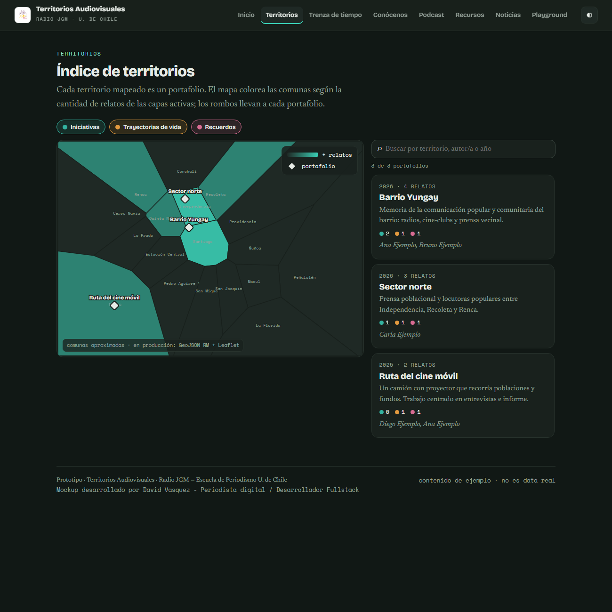
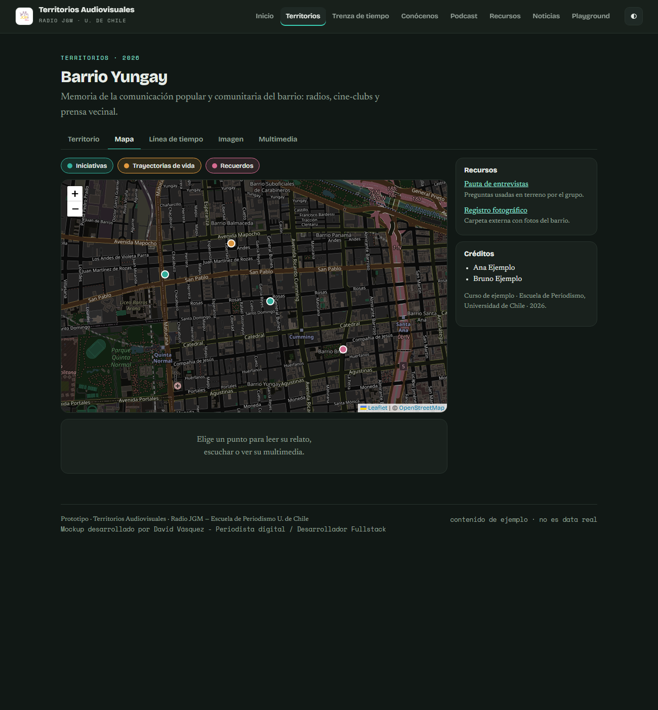
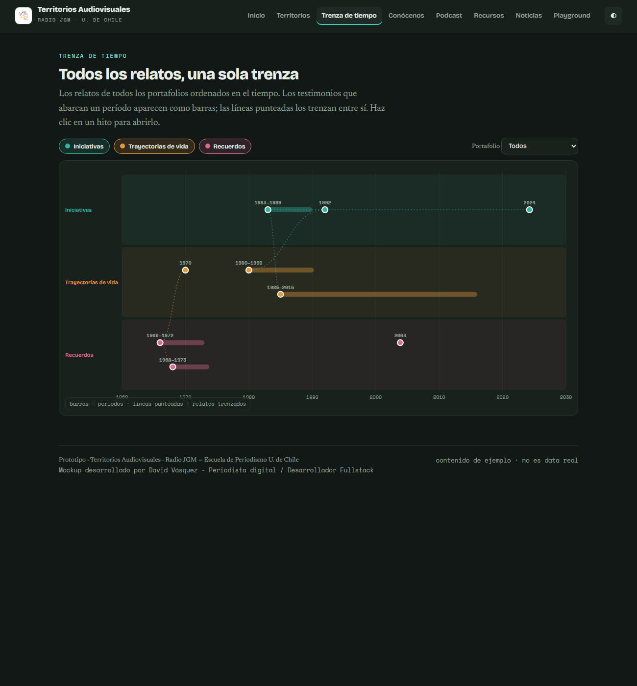
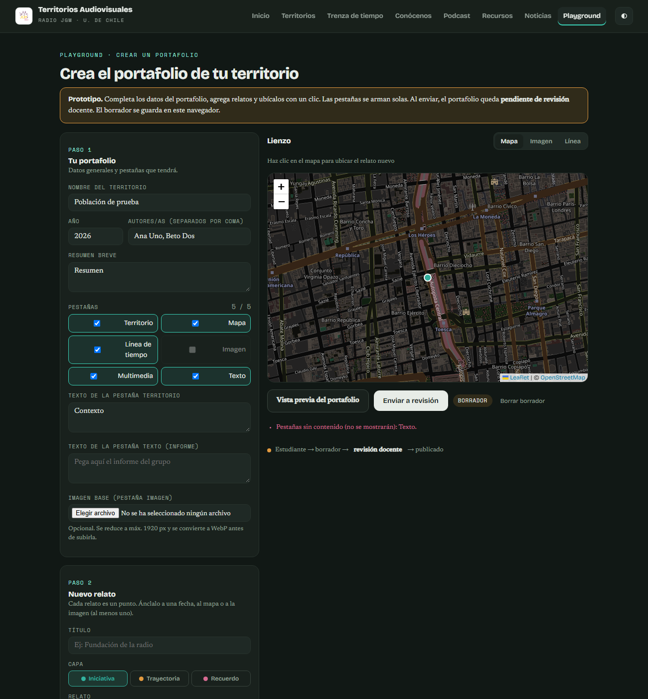

# Territorios Audiovisuales — Prototipo

Prototipo navegable de la plataforma de **Territorios Audiovisuales** para **Radio JGM** (Escuela de Periodismo — Facultad de Comunicación e Imagen, Universidad de Chile).

> **Estado:** prototipo / *mock* (v2). El contenido es de ejemplo y no representa territorios ni personas reales.

## La idea: un corpus, varias lentes

Cada **territorio** es un **portafolio**. Cada portafolio reúne **relatos**: puntos con texto y multimedia embebida que se anclan a una fecha, a un lugar del mapa o a una posición sobre una imagen. El relato se carga una vez y se proyecta en cada formato. Las capas son *Iniciativas · Trayectorias de vida · Recuerdos*.

| Sección | Qué muestra |
|---|---|
| **Territorios** | Índice: mapa de comunas coloreado por cantidad de relatos + buscador de portafolios. |
| **Portafolio** | Hasta 5 pestañas de un catálogo de 6: Territorio, Mapa (zoom al territorio), Línea de tiempo, Imagen, Multimedia y Texto. Recursos y créditos al costado. |
| **Trenza de tiempo** | Todos los relatos en una línea; los períodos (testimonios) como barras y las relaciones como hilos. Abre cada relato en un pop-up con su video. |
| **Recursos** | Material de apoyo de todos los portafolios, con buscador. |
| **Playground** | Editor para crear un portafolio: datos, pestañas, relatos ubicados con un clic, imagen base optimizada en el navegador y envío a revisión docente. |

La forma de los datos está definida en el [contrato de datos v2](docs/contrato-v2.md). El mock la consume tal cual, así que portar al plugin de WordPress es cambiar `js/api.js` por llamadas al REST.

## Capturas






## Cómo verlo

Abre `index.html` en el navegador (doble clic) o publícalo en GitHub Pages. No requiere instalación. Mapa, celdas de comunas y tipografías se cargan desde CDN (solo en el mock; el plugin las sirve vendorizadas).

## Estructura

```
index.html        estilos y estructura de las pantallas
js/core.js        lógica pura del contrato (fechas, embeds, pestañas, agregados)
js/datos.js       datos de ejemplo con la forma del contrato v2
js/api.js         API simulada: mismas rutas que el REST del plugin
js/visores.js     índice, mapa (Leaflet), línea de tiempo, imagen, multimedia, ficha
js/app.js         navegación por hash, pantallas y playground
tests/            pruebas de js/core.js
docs/             contrato de datos y brief
```

## Pruebas

```
npm test
```

Usa el runner nativo de Node (18+), sin dependencias.

## Autor

**David Vásquez Ovalle** — desarrollo web y comunicación.

## Licencia

MIT — ver [LICENSE](LICENSE).
